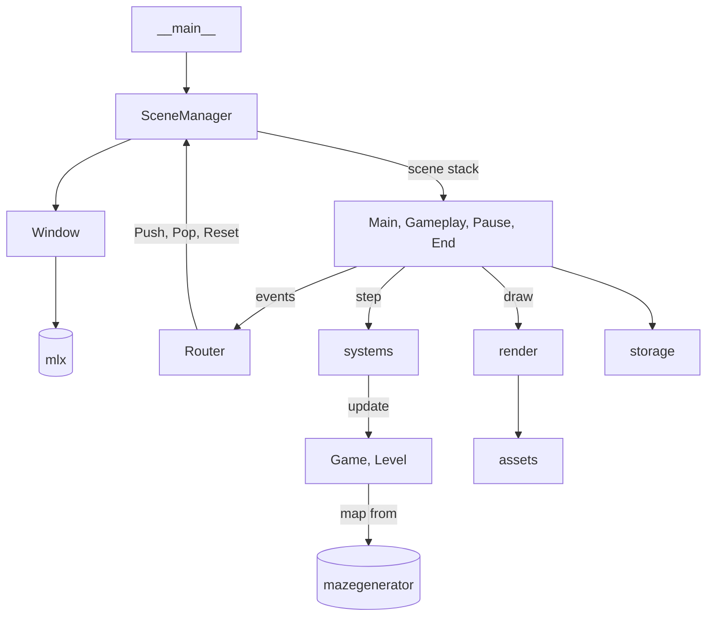

*This project has been created as part of the 42 curriculum by gviola-l, mphippen.*

# Pac-Man

## Table of Contents
- [Description](#description)
- [Instructions](#instructions)
- [Configuration](#configuration)
- [Highscore](#highscore)
- [Maze Generation](#maze-generation)
- [Implementation](#implementation)
- [General Software Architecture](#architecture)
- [Project Management](#project-management)
- [Resources](#resources)

---

<a name="description"></a>
## `🔍` | Description

**Pac-Man** is a Python remake of the 1980 arcade game, rendered with the 42 MiniLibX and played on mazes from the 42 project "A-Maze-ing".

Pac-Man has to eat every pac-gum in the maze while four ghosts chase him, each with its own targeting rule. A super pac-gum frightens them for 10 seconds, and frightened ghosts can be eaten. Each level is a new maze whose "42" pattern becomes the ghost house. Clearing `levels_to_win` levels (3 by default) wins the game; losing every life or running out of time on a level ends it. The score can then be saved to a top-10 leaderboard.

---

<a name="instructions"></a>
## `📝` | Instructions

```shell
# Ensure Git, Python 3.10+ and uv are installed
git clone https://github.com/Gqtien/Pac-Man.git
cd Pac-Man

make                       # run with config.json
make run other_config.json # run with another config file
```

| Key             | Action                                                             |
| --------------- | ------------------------------------------------------------------ |
| `↑` `↓` `←` `→` | Move.                                                              |
| `Escape`        | Pause. `Escape` again resumes, `Enter` goes back to the menu       |
| `Space`         | Start a game from the menu                                         |
| `←` `→`         | On the menu, switch between the leaderboard and the controls page  |
| `Q`             | Quit from the menu                                                 |
| `I` `F` `W`     | Cheats: invincibility, frozen ghosts, clear the level              |

---

<a name="configuration"></a>
## `⚙️` | Configuration

The game reads a JSON object from its first argument, `config.json` by default. Every key is optional:

| Key                       | Default                  | Allowed   | Meaning                                                     |
| ------------------------- | ------------------------ | --------- | ----------------------------------------------------------- |
| `lives`                   | `3`                      | 1 – 99    | lives at the start of a game                                |
| `levels_to_win`           | `3`                      | 1 – 99    | levels to clear to win                                      |
| `level_time_limit`        | `180`                    | 1 – 3600  | seconds allowed per level                                   |
| `speed`                   | `10.0`                   | 1 – 15    | base speed, in tiles per second                             |
| `entity_hitbox`           | `0.5`                    | 0.25 – 1  | distance between two centers that counts as a hit, in tiles |
| `cheat_win_key`           | `"w"`                    | a letter  | key that clears the level                                   |
| `cheat_invincible_key`    | `"i"`                    | a letter  | key that toggles invincibility                              |
| `cheat_freeze_ghosts_key` | `"f"`                    | a letter  | key that toggles frozen ghosts                              |
| `highscore_path`          | `"saves/highscore.json"` | see below | leaderboard file                                            |

If the file is missing or isn't valid JSON, every default is used. A value outside what is allowed falls back to its default with a warning, and an unknown key is ignored. `highscore_path` must be a highscore file, or a new file in an existing folder, so saving a score never overwrites another file. Missing keys are written back to the file with their defaults.

---

<a name="highscore"></a>
## `🏆` | Highscore

When a game ends, the end screen asks for a name of up to 10 characters. `Enter` saves the score and `Escape` leaves without saving. Scores are stored in `saves/highscore.json` as a JSON object from names to scores:

```json
{ "GATIEN": 4210, "MARCEL": 2980 }
```

Each name keeps only its best score, and only the 10 best names are kept, best first. The main menu lists them. Entries with a name longer than 10 characters or a score that isn't a whole number between 0 and 9,999,999 are ignored.

We kept the format plain JSON so it needs no extra dependency, can be read and fixed by hand, and goes through the same helpers as the config (`src/storage/files.py`).

---

<a name="maze-generation"></a>
## `🧩` | Maze Generation

The mazes come from `mazegenerator` 2.1.0, the A-Maze-ing package we were assigned. Its wheel is in `wheels/`, `pyproject.toml` points `uv` at it, and the whole integration is one call in `src/models/map.py`:

```python
def new_map(seed: int = 0) -> Map:
    return from_maze(MazeGenerator(seed=seed).maze)
```

We keep the package defaults, a 15 × 15 imperfect maze. The first level always uses seed `42`; later levels are random.

The package returns one integer per cell, with a bit per wall (N = 0001, E = 0010, S = 0100, W = 1000). The closed "42" cells become the ghost house, with two doors facing each other across the gap between the "4" and the "2".

Blinky (`B`) starts between the doors, Clyde (`C`) and Pinky (`P`) inside the "4", and Inky (`I`) inside the "2".

---

<a name="implementation"></a>
## `🛠️` | Implementation

- The mlx loop runs the game at 60 fps. Movement uses the time elapsed since the last frame, so the game runs at the same speed on any machine.
- The game rules live in `systems.step()`. It updates the game, respawns Pac-Man after a death and builds the next level when the maze is cleared. It only returns an outcome when the game ends: won, lost or timed out.
- Pac-Man and the ghosts move from tile to tile, with a progress value between two tiles so the movement stays smooth.
- Each ghost finds its way with a breadth-first search toward its own target, as in the arcade: Blinky aims at Pac-Man, Pinky in front of him, Inky uses Blinky's position, and Clyde runs back to his corner when he gets too close.
- Each frame is drawn into a Pillow image, then copied into an mlx image. The window takes the desktop's work area, and each sprite is scaled to the exact tile size that fits it: enlarged by a whole number without smoothing, then reduced to the final size by averaging, so the pixel art keeps its proportions at any size.

---

<a name="architecture"></a>
## `🏗️` | General Software Architecture

```
src/
├── __main__.py   reads the arguments, loads the config and assets, opens the window, starts the scenes
├── models/       data: Vec2, Direction, Pacman, Ghost, Game, Level, maze conversion, game tables
├── systems/      game rules: step(game, config, dt, keys) -> Outcome | None
├── scenes/       scene stack, router, menu, game, pause and end screens
├── render/       mlx window, drawing into the framebuffer
├── assets/       sprite sheets cut into sprites, fonts and wall tiles
└── storage/      config and highscore files
```



`models` holds plain data and pure helpers. A `Game` keeps what lasts the whole game (score, lives, cheats) and the current `Level` (maze, items, Pac-Man, ghosts and their timers), so moving on to the next level only replaces the `Level`. `systems` holds every game rule as functions that update the `Game`; `step` returns an `Outcome` only when the game ends.

Scenes are thin glue: they call `systems.step` and `render`, and never open another scene themselves. They return an event instead (start, pause, resume, finish, leave, quit), and the `Router` is the only place that knows which screen comes next: it turns each event into a `Push`, `Pop` or `Reset` of the scene stack. `render` draws into the framebuffer and shows it in the mlx window, `assets` only loads images, and `storage` is the only package that reads or writes JSON.

---

<a name="project-management"></a>
## `📋` | Project Management

We were two and split the work by feature: [Gatien](https://github.com/Gqtien) did the architecture, the maze, the rendering, collisions and levels; [Marcel](https://github.com/PurpleProg) did the ghost AI, the highscores, the menus and the port from tkinter to mlx.

---

<a name="resources"></a>
## `📚` | Resources

### Docs

- [The Pac-Man Dossier](https://pacman.holenet.info/), for all the exact details of the original game

### AI usage

AI was used to:
- Fuzz the game to surface edge-case failures
- Draft this README
